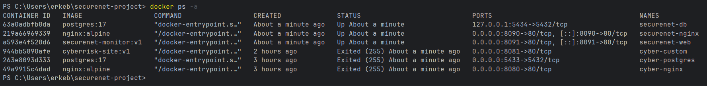
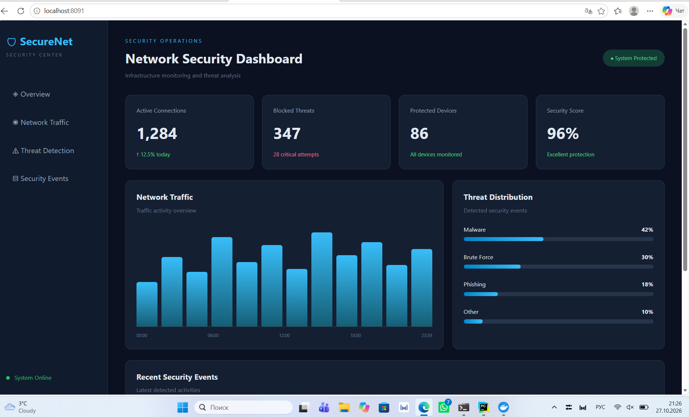
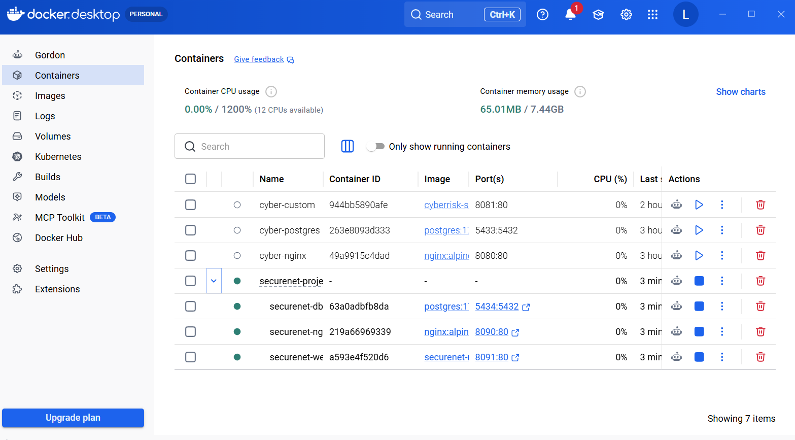

# SecureNet Monitor

## SRO №3 — Docker Project

SecureNet Monitor is a Docker-based cybersecurity
project demonstrating containerization using
three services.

## Docker Containers

| Container | Image | Port |
|-----------|-------|------|
| securenet-nginx | nginx:alpine | 8090 |
| securenet-db | postgres:17 | 5434 |
| securenet-web | securenet-monitor:v1 | 8091 |

## Technologies

- Docker & Docker Compose
- Nginx
- PostgreSQL
- HTML / CSS

## Run Project

```bash
docker compose up -d --build
```

## Check Containers



```bash
docker ps
```

## Website



## Screenshots

### Docker Containers




## Conclusion

The project demonstrates Docker containerization
with Nginx, PostgreSQL, and a custom security
dashboard.
